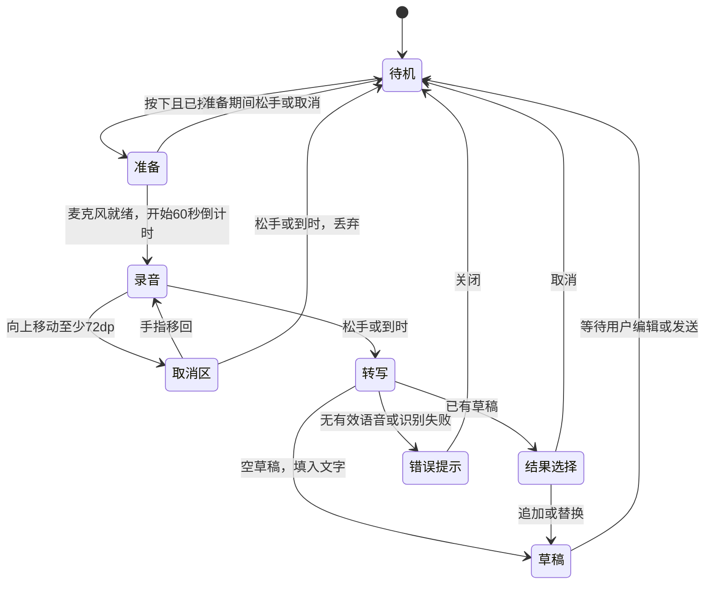

# 按住说话：状态图与交互演示

> 历史方案与试验记录：当前主应用的识别引擎、模型开关和构建方式以 [X-ASR 迁移记录](../testing/voice-xasr.md) 为准；按住录音与编辑交互仍保留。

2026-10-23，基于当前未发布 Compose 实现绘制。**以下为布局与交互示意，不是 Android 实机截图，也不构成麦克风或识别性能的验证。**

- [打开可交互 HTML](mockups/voice-hold-v1.html)：支持按住准备、录音倒计时、上滑取消、滑回继续、松手模拟转写，以及明暗主题切换。浏览器不会请求麦克风或发送音频；勾选加速时 1 秒模拟 5 秒，实际产品上限仍为 60 秒。
- 八个状态总览 PNG（历史截图已清理）：准备、绿色录音、最后十秒、剩五秒、最后一秒、上滑取消、转文字、已有草稿的追加/替换。
- 单屏演示 PNG（历史截图已清理）：录音光晕与底栏布局。
- [实现及设备验证范围](../testing/voice-hold-input.md)、[100 MB 模型预算](voice-model-budget.md)。

录音光晕与底栏示意（历史截图已清理）

八个状态与流转示意（历史截图已清理）

## 交互规则

麦克风就绪后才显示绿色光晕并从 60 秒开始计时。10～5 秒从绿渐变到橙，5～0 秒从橙渐变到红；上滑至少 72 dp 则直接显示红色与“松手取消录音”。时间紧张和取消录音都用红色时，通过文字明确区分含义。

准备时松手直接取消；录音时松手转写；上滑后松手丢弃，滑回则继续录音。转写只写入可编辑草稿；已有内容时由用户选择追加或替换。首次授权后需重新按住，退后台或切换连接取消。

录音覆盖层不获取焦点，保留原有 156 dp 底栏及 52 dp 中央按钮。无障碍用户可点击开始、再次点击结束；HTML 的手势演示主要展示普通触摸路径。

录音、准备与转写均受会话代次及目标校验保护；切换连接、退后台、系统取消手势等退出路径详见实现记录。图中省略这些跨状态分支，以突出按住及上滑操作。

## 本页检查

浏览器检查包括八张状态卡、普通松手、准备中松手、上滑取消、滑回后松手、明暗切换与页面脚本错误。PNG 从同一 HTML 导出；Compose 手势、真实音频和 60 秒录音仍以设备验收为准。
