# 当前程序界面缩略图

代码快照：`c6a672b`。点击图片查看原图；筛选、来源和范围见 [交互图集](index.html) 与 [采集说明](README.md)。

部分图片使用固定状态或离线终端正文，类型标在每张图下方。

## 主界面与分组

| 界面 | 界面 | 界面 |
| --- | --- | --- |
| <a href="home/01-empty.png">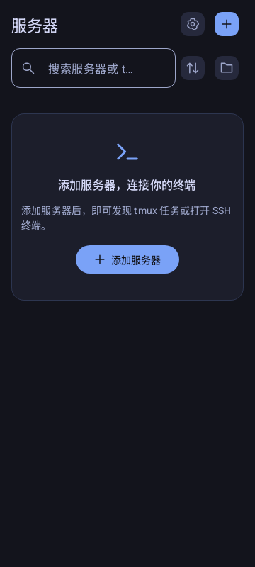</a> 首次打开：空服务器列表 实际程序界面 |  主界面：分组、服务器、任务状态 实际程序界面 | <a href="home/03-sort-menu.png">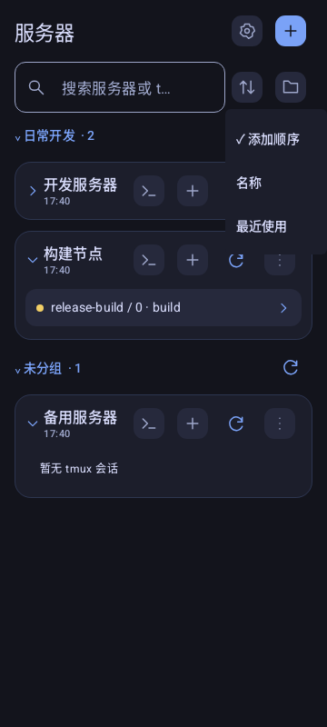</a> 服务器排序菜单 实际程序界面 |
|  本地搜索：匹配任务 实际程序界面 | <a href="home/05-search-empty.png">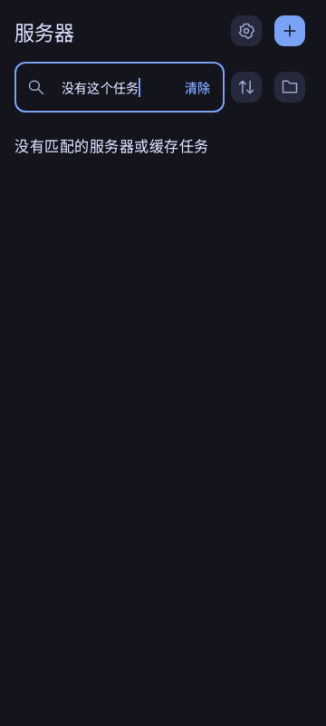</a> 搜索无结果 实际程序界面 | <a href="home/06-folder-collapsed.png">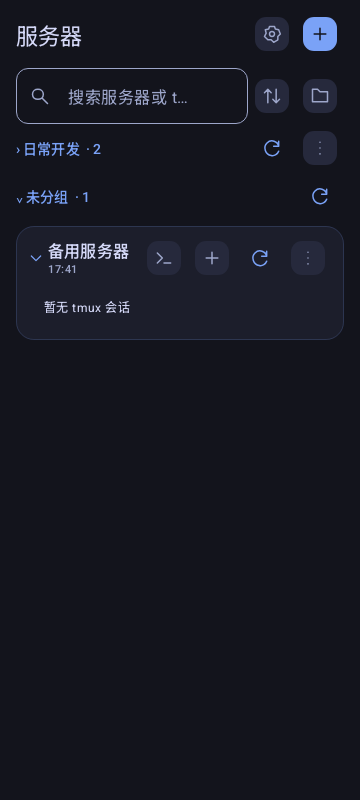</a> 分组折叠 实际程序界面 |
| <a href="home/07-folder-new.png">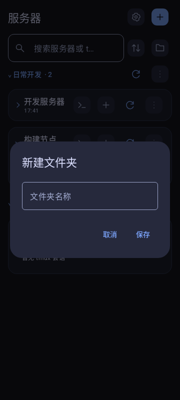</a> 新建分组弹窗 实际程序界面 | <a href="home/08-server-menu.png">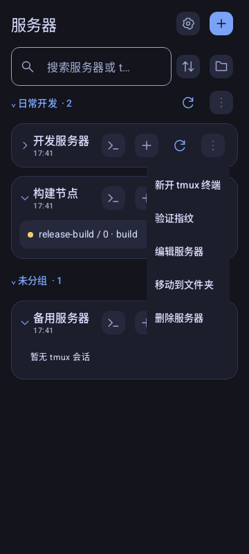</a> 服务器更多操作 实际程序界面 | <a href="home/09-light.png">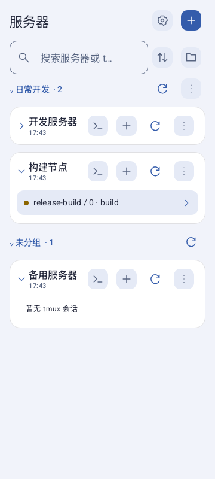</a> 主界面：浅色 实际程序界面 |
| <a href="home/10-folder-menu.png">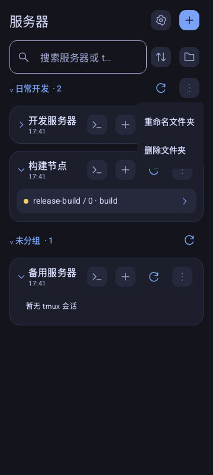</a> 分组操作菜单 实际程序界面 | <a href="home/11-folder-rename.png">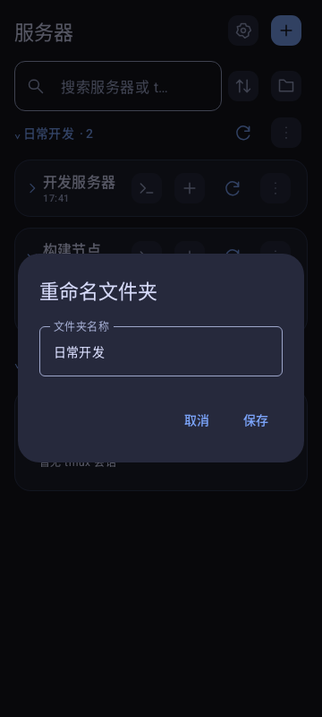</a> 重命名分组 实际程序界面 | <a href="home/12-folder-delete.png">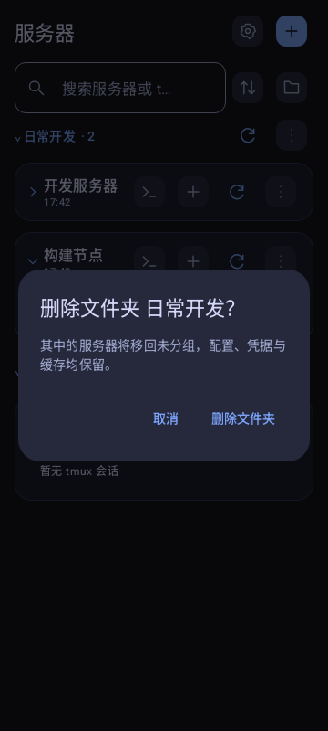</a> 删除分组确认 实际程序界面 |
| <a href="home/13-move-server.png">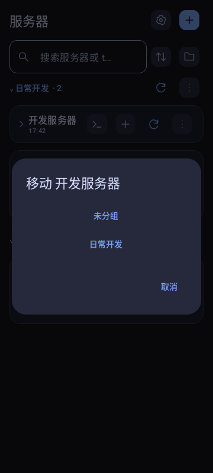</a> 移动服务器到分组 实际程序界面 | <a href="home/14-delete-server.png">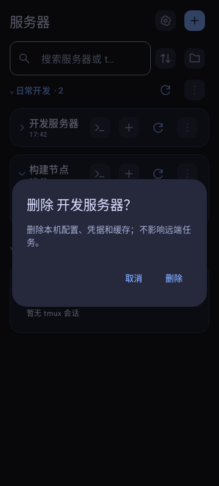</a> 删除服务器确认 实际程序界面 | <a href="home/15-server-collapsed.png">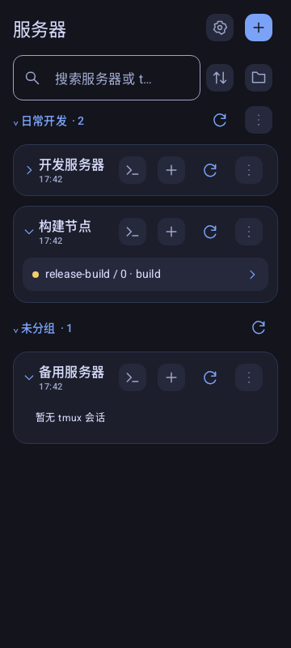</a> 服务器任务列表折叠 实际程序界面 |
| <a href="home/16-multiple-panes.png">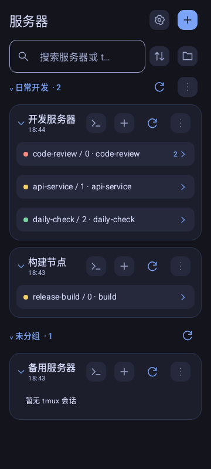</a> 同一 tmux 窗口包含多个 pane 实际程序界面 | <a href="home/17-panes-expanded.png">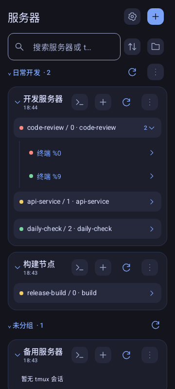</a> 展开窗口：逐个选择 pane 实际程序界面 | <a href="home/18-unknown-states.png">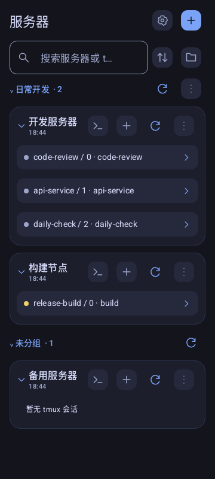</a> 任务状态：灰色未知 / 已过期 实际程序界面 |
| <a href="home/19-last-used.png">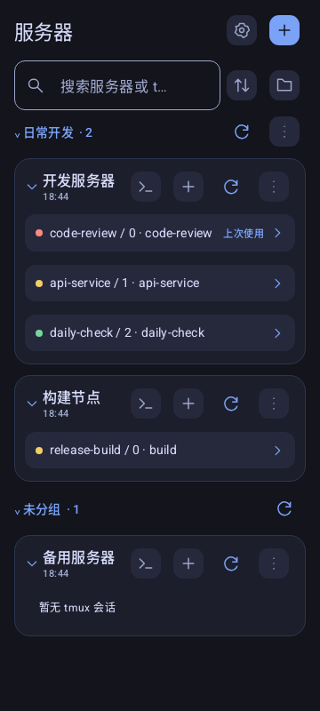</a> 最近使用的任务标记 实际程序界面 | <a href="home/20-folder-duplicate.png">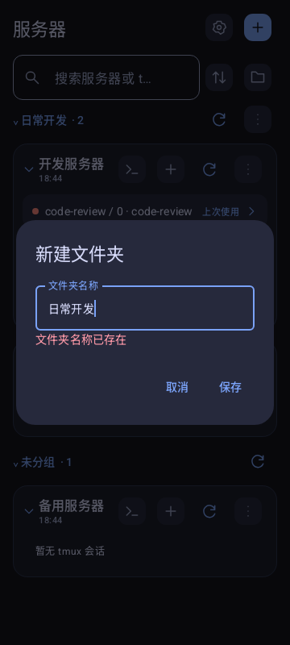</a> 新建分组：重名校验 实际程序界面 | <a href="home/theme-catppuccin.png">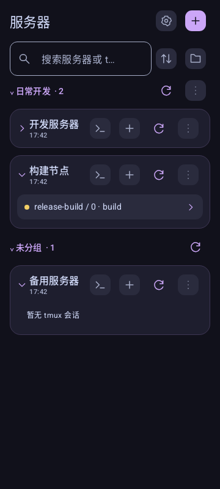</a> 主界面主题：CATPPUCCIN 实际程序界面 |
| <a href="home/theme-emerald.png">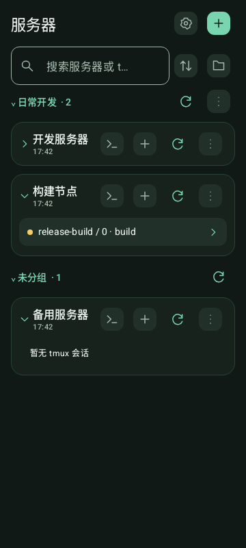</a> 主界面主题：EMERALD 实际程序界面 | <a href="home/theme-nord.png">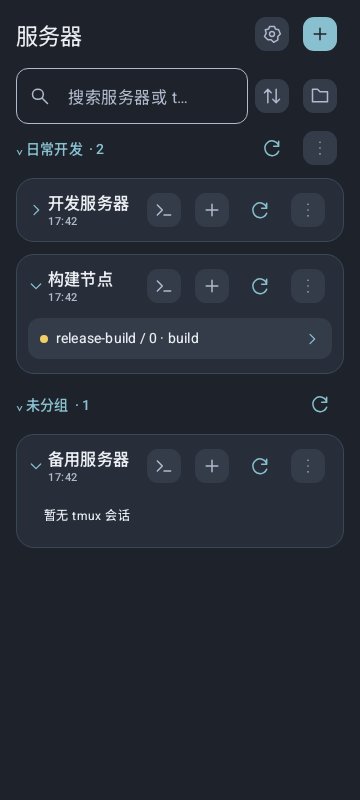</a> 主界面主题：NORD 实际程序界面 | <a href="home/theme-paper.png">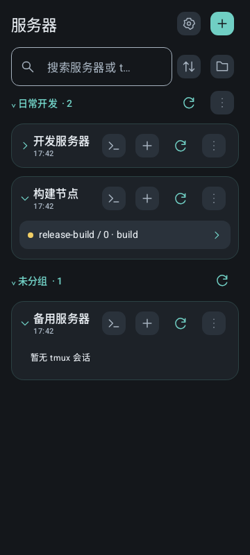</a> 主界面主题：PAPER 实际程序界面 |
|  主界面主题：TOKYO 实际程序界面 | <a href="home/theme-zinc.png">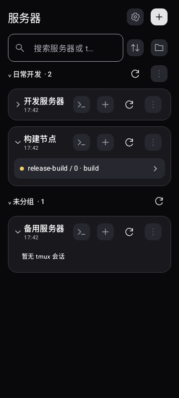</a> 主界面主题：ZINC 实际程序界面 |  |

## SSH 登录与服务器配置

| 界面 | 界面 | 界面 |
| --- | --- | --- |
| <a href="server/01-add-key.png">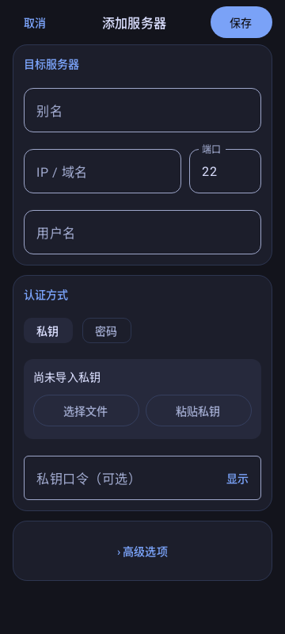</a> 添加服务器：私钥认证 实际程序界面 | <a href="server/02-add-password.png">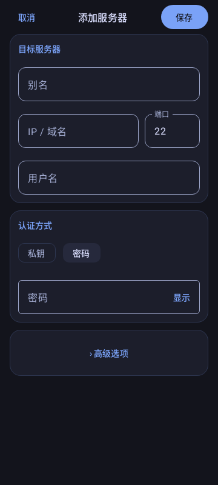</a> 添加服务器：密码认证 实际程序界面 | <a href="server/03-edit-password.png">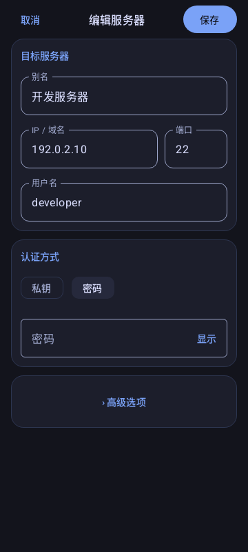</a> 编辑服务器：密码认证 实际程序界面 |
| <a href="server/04-advanced.png">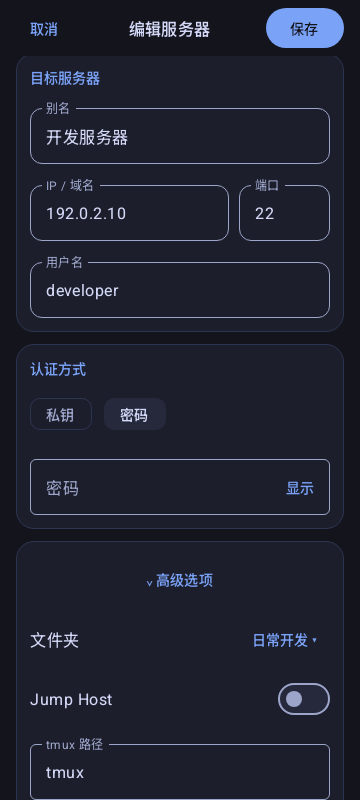</a> 高级设置：分组、Jump Host、tmux 路径与鼠标 实际程序界面 | <a href="server/05-folder-picker.png">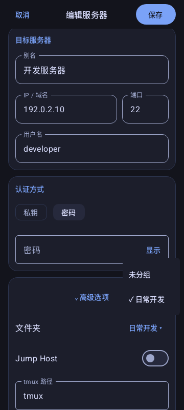</a> 服务器所属分组菜单 实际程序界面 | <a href="server/06-validation.png">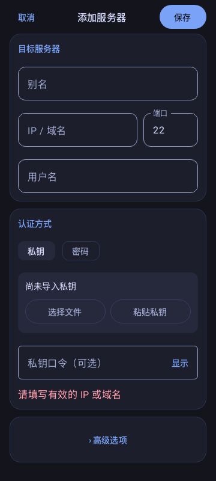</a> 保存校验失败：目标信息不完整 实际程序界面 |
| <a href="server/07-abandon.png">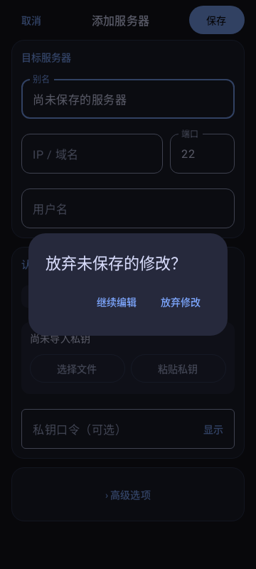</a> 放弃未保存的修改 实际程序界面 | <a href="server/08-key-paste.png">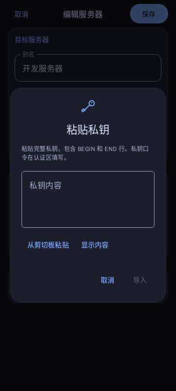</a> 粘贴 SSH 私钥 实际程序界面 | <a href="server/09-import-jump.png">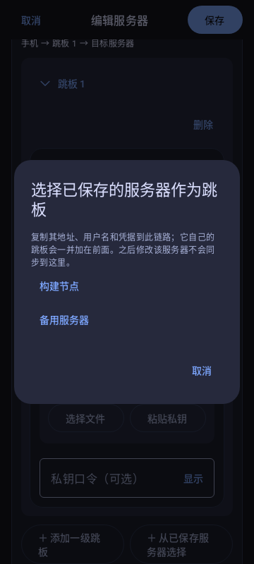</a> 从已保存服务器导入跳板 实际程序界面 |
| <a href="server/10-jump-expanded.png">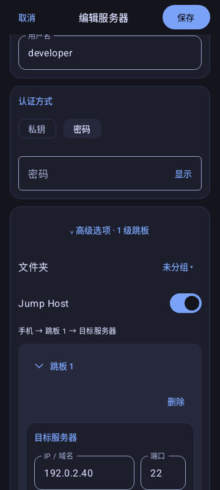</a> Jump Host 认证与路由编辑 实际程序界面 | <a href="server/11-new-tmux.png">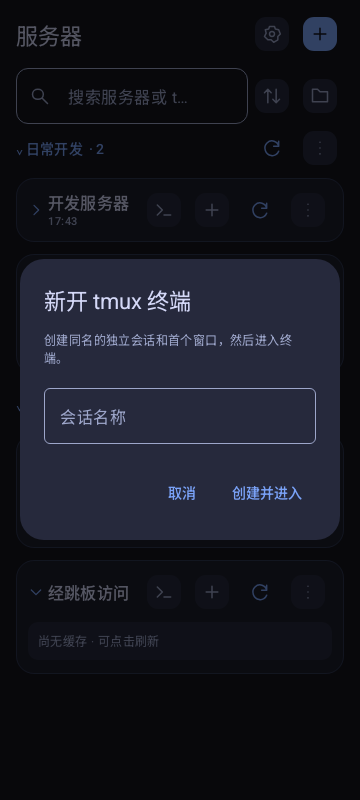</a> 新建独立命名 tmux 会话 实际程序界面 | <a href="server/12-new-tmux-invalid.png">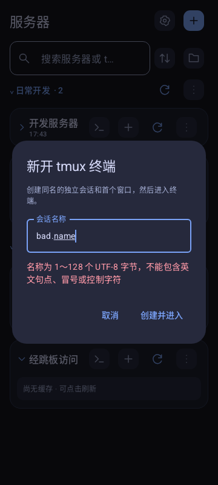</a> 新会话名称不合法 实际程序界面 |
| <a href="server/13-private-key-invalid.png">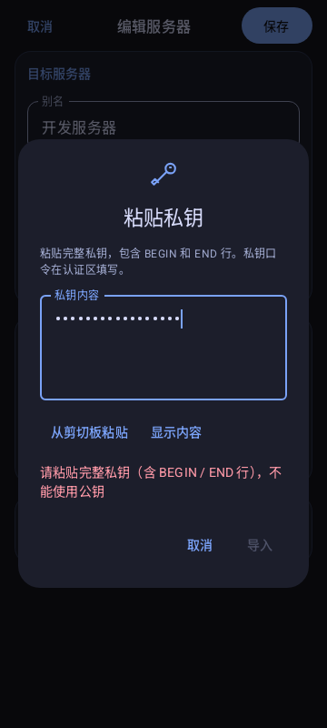</a> 粘贴私钥：格式错误提示 实际程序界面 |  |  |

## 设置

| 界面 | 界面 | 界面 |
| --- | --- | --- |
| <a href="settings/01-top.png">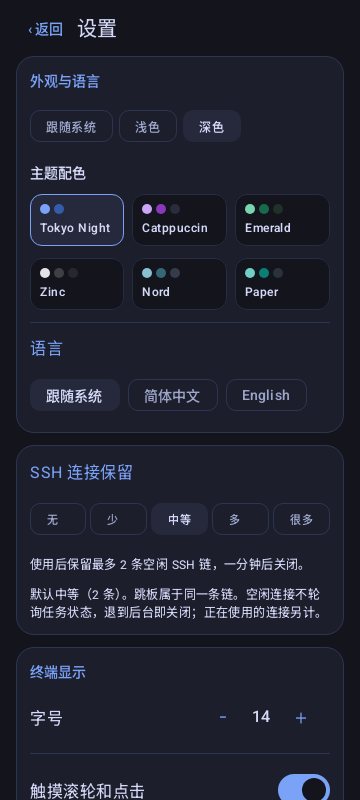</a> 设置：外观、主题与语言 实际程序界面 | <a href="settings/02-terminal.png">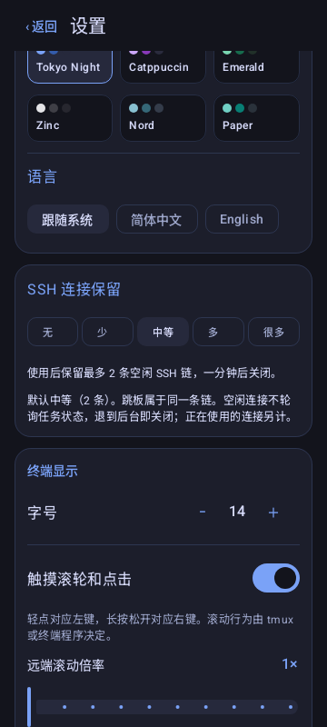</a> 设置：SSH 保留、终端显示与滚动倍率 实际程序界面 | <a href="settings/03-privacy-voice.png">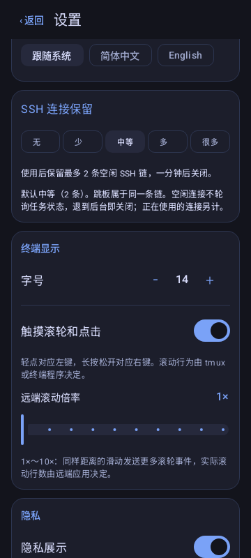</a> 设置：隐私与本地语音 实际程序界面 |
| <a href="settings/04-logs.png">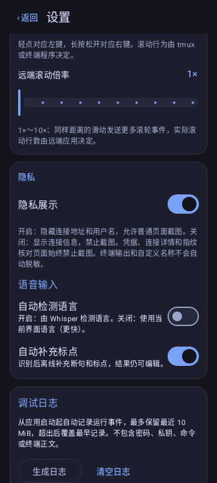</a> 设置：诊断日志导出与清除 实际程序界面 | <a href="settings/05-light.png">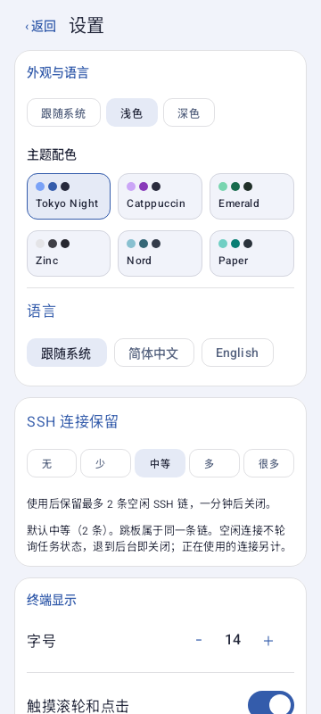</a> 设置：浅色主题 实际程序界面 |  诊断日志清除结果 实际程序界面 |

## 终端与输入

| 界面 | 界面 | 界面 |
| --- | --- | --- |
| <a href="terminal/01-agent.png">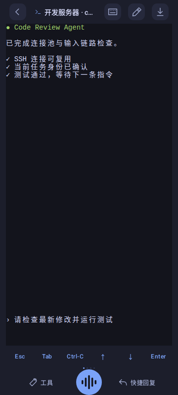</a> 终端：Agent 界面与直接输入 原生界面＋离线终端画面 | <a href="terminal/02-sticky.png">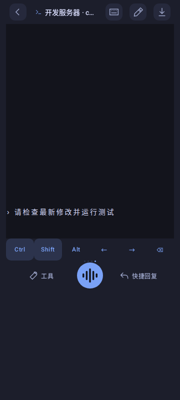</a> 终端：Ctrl + Shift 粘滞等待 原生界面＋离线终端画面 | <a href="terminal/03-editor.png">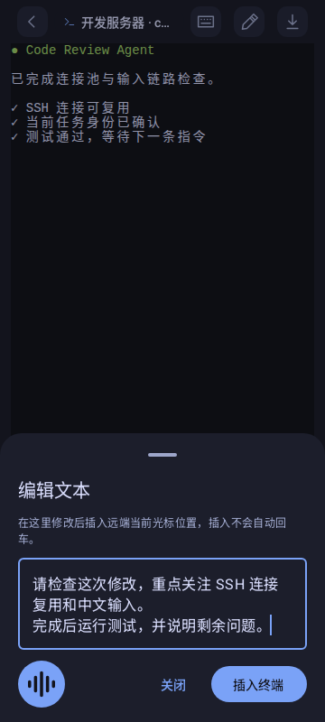</a> 终端：语音/长文本编辑卡片 原生界面＋离线终端画面 |
| <a href="terminal/04-editor-keyboard.png">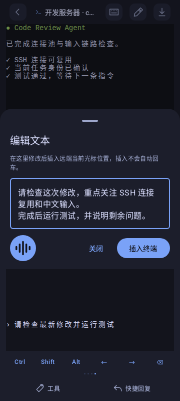</a> 编辑卡片：键盘避让布局 原生界面＋离线终端画面 | <a href="terminal/05-keyboard.png">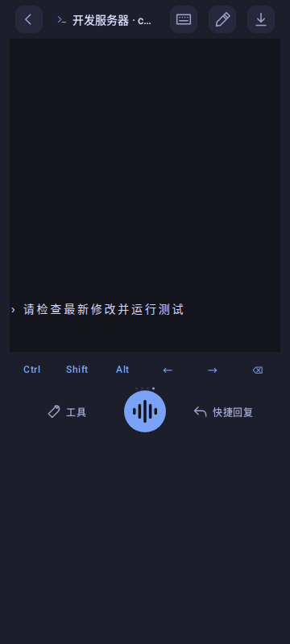</a> 终端直接输入：键盘避让布局 原生界面＋离线终端画面 | <a href="terminal/06-tools-top.png">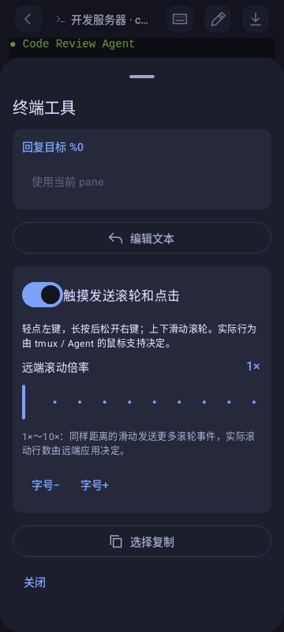</a> 终端工具：回复目标与输入 原生界面＋离线终端画面 |
| <a href="terminal/07-tools-display.png">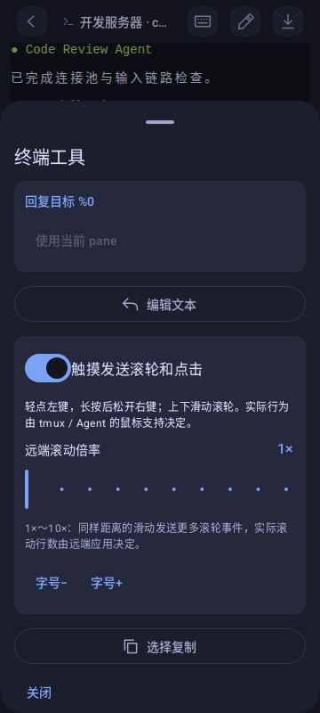</a> 终端工具：滚动、字号与复制 原生界面＋离线终端画面 | <a href="terminal/08-copy.png">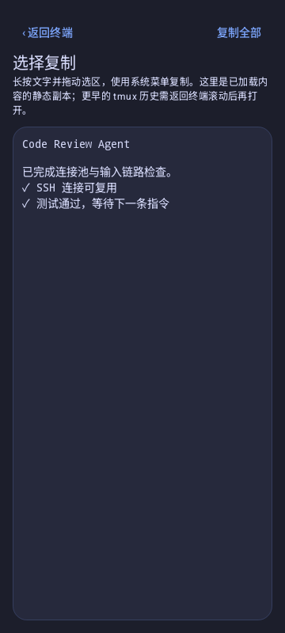</a> 终端文字静态副本与复制 原生组件固定状态 | <a href="terminal/09-replies.png">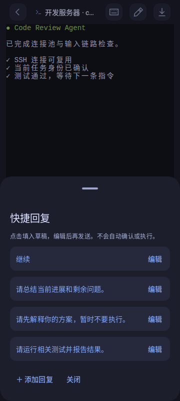</a> 快捷回复列表 原生界面＋离线终端画面 |
|  添加快捷回复 原生界面＋离线终端画面 |  编辑/删除快捷回复 原生界面＋离线终端画面 |  终端连接详细信息 原生界面＋离线终端画面 |
|  终端：连接准备中 原生界面＋离线终端画面 |  终端：认证失败 原生界面＋离线终端画面 |  终端：断线后的历史与重连 原生界面＋离线终端画面 |
|  终端：回复目标校验拦截 原生界面＋离线终端画面 |  终端：浅色主题 原生界面＋离线终端画面 |  终端：首次指纹确认 原生界面＋离线终端画面 |
|  终端：主机密钥变化拦截 原生界面＋离线终端画面 |  复制窗口：暂无终端文字 原生组件固定状态 |  复制窗口：内容裁剪提示 原生组件固定状态 |
|  普通版终端：没有语音按钮的底栏 原生组件固定状态 |  F1–F6 快捷键 原生界面＋离线终端画面 |  F7–F12 快捷键 原生界面＋离线终端画面 |
|  Ctrl / Shift / Alt 与编辑键 原生界面＋离线终端画面 |  |  |

## 语音状态

| 界面 | 界面 | 界面 |
| --- | --- | --- |
|  语音：麦克风准备中 原生组件固定状态 |  语音：录音与绿色倒计时 原生组件固定状态 |  语音：最后十秒变橙 原生组件固定状态 |
|  语音：即将结束变红 原生组件固定状态 |  语音：上滑松手取消 原生组件固定状态 |  语音：本机转写中 瞬时分支预览 |
|  语音录音：浅色主题 原生组件固定状态 |  麦克风权限被拒绝，仍可继续键盘输入。 瞬时分支预览 |  无法启动或读取麦克风，请检查是否被其他应用占用。 瞬时分支预览 |
|  录音太短，请至少说 0.1 秒。 瞬时分支预览 |  未识别到语音，草稿没有改变。 瞬时分支预览 |  内置 Whisper 模型缺失或损坏，请重新安装 voice APK。 瞬时分支预览 |
|  连接或回复目标已改变，语音文字未填入。 瞬时分支预览 |  语音转写失败，原草稿没有改变。 瞬时分支预览 |  |

## 验证与确认分支

| 界面 | 界面 | 界面 |
| --- | --- | --- |
|  核对主机指纹 瞬时分支预览 |  主机密钥已改变 瞬时分支预览 |  验证并保存服务器 瞬时分支预览 |
|  核对主机指纹 瞬时分支预览 |  核对主机指纹 瞬时分支预览 |  服务器验证失败，尚未保存 瞬时分支预览 |
|  正在创建 tmux 会话… 瞬时分支预览 |  已存在同名 tmux 会话，请使用其他名称 瞬时分支预览 |  无法确认 tmux 会话创建结果，请刷新列表检查后重试 瞬时分支预览 |
|  快捷回复：追加、替换或取消 瞬时分支预览 |  |  |
