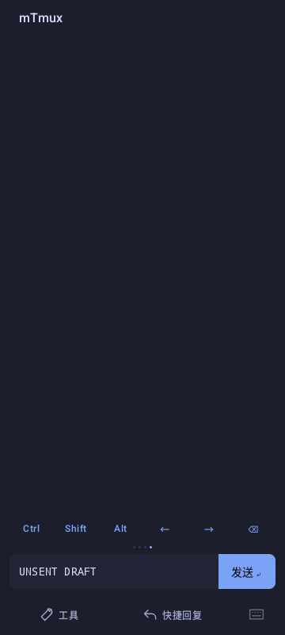
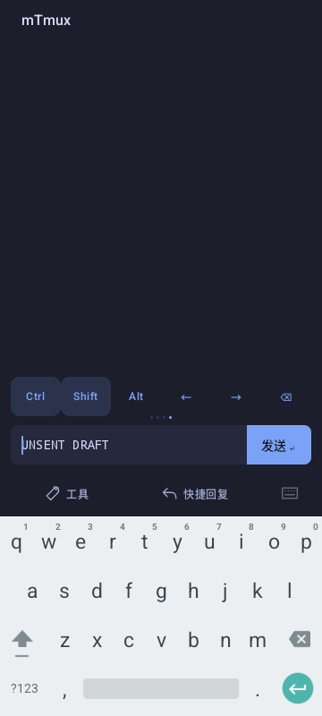

# 终端底栏、粘滞组合键与循环翻页

2026-10-22，0.8.4（versionCode 32）的终端输入与底栏改动。

## 使用方式

底栏保留 48 dp 快捷键、56 dp 输入区、52 dp 辅助操作区。发送放入输入框右侧，快捷键与辅助操作透明底，控件间不画分隔线。远端终端仍按原来的总计 204 dp 顶/底栏预算计算逻辑网格。

辅助操作区移除“收起键盘”。标准版的工具和快捷回复各占半栏，在各自区域内居中；voice 版中间增加直径 52 dp 的圆形语音输入按钮，图标为 30 dp，工具和快捷回复分别在两侧剩余空间内居中。中间区域按内容宽度布局，标准版没有额外的中央占位，voice 版圆形按钮保持几何居中；大字体时两侧文字可缩短或省略。键盘可通过 Android 系统返回手势/按键收起，语音录入仍会主动收起键盘。

声波图标原文件已移至 [voice.svg](../design/assets/voice.svg)，等形转换为 voice flavor 专用的 `app/src/voice/res/drawable/ic_voice_input.xml`，无位图拉伸或运行时 SVG 解析。可用按钮的圆底使用主题 `primary`，图标使用 `onPrimary`；不可用时使用主题的弱化底色和图标色。

当前布局的 [效果图 PNG](../design/mockups/terminal-dock-v3.png) / [HTML 预览](../design/mockups/terminal-dock-v3.html) 展示标准版与深浅色语音版。按当前代码的尺寸和主题色绘制，使用原声波 SVG 路径；属于设计示意，不计入下面的 Android 设备截图或测试证据。

快捷键共四页：常用键、F1～F6、F7～F12、Ctrl / Shift / Alt / 左 / 右 / 退格。右滑进入下一页，第四页继续右滑回到第一页；第一页左滑进入第四页。翻页保留待用组合键。

2026-10-23 后续修正（未发布）：页码亮点使用当前逻辑页与拖动偏移连续绘制。进入下一页时随手势移动；首尾循环从两侧边缘衔接，避免直接从一端跳回另一端。计算前先对大虚拟页码取模，保留小幅拖动精度；不增加独立动画定时器或改变快捷键页序。

- 点击 Ctrl、Shift、Alt 后高亮，可依次叠加；再次点击同一个键取消。
- 下一次字符、方向键或功能键使用该组合并释放。软键盘与实体键盘均走这项规则，已有草稿保持原样。例如 Ctrl → a 发送 `0x01`，Ctrl → e 发送 `0x05`，Shift → i 发送大写 `I`。
- 软键盘单字符组词回调只消费一次；被消费的旧输入连接失效，后续的同字符提交不会重发或落进草稿。软键盘在等待组合时请求 ASCII 输入，释放后恢复正常输入方式。
- 多字符输入作为草稿编辑并取消等待；快捷回复、语音、发送、工具面板，以及连接/回复目标变化和退后台会清理等待状态。连续长按实体按键不在释放修饰键后向草稿补入重复字符。
- 发送继续使用既有连接和目标 pane 的受校验输入路径；不增加 SSH 握手或调整远端 tmux 配置。

## 兼容性

采用传统终端编码：Ctrl 字母为 C0 控制码，Shift 字母为大写，Alt 为 ESC 前缀；方向键和 F 键采用带修饰参数的序列。本轮不新增 Kitty / CSI-u / modifyOtherKeys 扩展协议。传统协议不能保证区分 Ctrl+C 与 Ctrl+Shift+C，具体快捷键含义仍由远端程序决定；相关背景见 [tmux 官方修饰键说明](https://github.com/tmux/tmux/wiki/Modifier-Keys)。

## 验证

- 新增 `TerminalKeyStrokeTest` 7 项：Readline/Vim 字符、Ctrl/Shift/Alt 组合、功能键与方向键、非法输入、单次状态消费、双向首尾循环、旧 IME 回调隔离。
- 独立 tmux socket、空配置下实际检查：向 Readline 输入 `abcdef` → Ctrl+A → `H` → Ctrl+E → `T`，结果为 `HabcdefT`；Vim 普通模式接收大写 `I` 后在行首插入，文件结果为 `helloabc`。测试只使用临时 session/socket/file，结束后清理。
- 新增 `TerminalKeyboardTest`：使用 debug 专用、未导出的 ComponentActivity，避开 WebView 启动；检查真实 Android 输入连接、实体键盘、草稿保留、高亮释放和循环翻页。此测试 Activity 不进入 release manifest。
- standard / voice 的 app 单元测试分别 15 项通过（0 失败、0 跳过），两种 debug APK 及两种 Android 测试 APK 构建通过；两种 lint 均为 0 错误。使用 JDK 17 和仓库 Gradle wrapper。
- 粘滞键实现阶段的 standard Android 组件用例两项完成验证：`circularPagesAndImeShortcutsLeaveDraftUntouched` 检查双向循环、真实 Android 输入连接的 Ctrl+A / Ctrl+E / Shift+I、旧连接不重放及组合方向键，首轮通过；`hardwareKeyReleasesLatchAndNormalTypingStillEditsDraft` 检查实体按键、后续普通草稿输入和取消等待，修正测试的文本匹配断言及 IME 改变窗口位置时的点击坐标依赖后，单项复测通过（`OK (1 test)`）。
- 随后的左右按钮与圆形语音按钮调整已重新通过上述双版本构建、单元测试和 lint。现有布局测试已更新为“无收起键盘、工具 / 语音 / 回复居中且不重叠”，原来依赖收起按钮的测试改为主动隐藏输入法；组件截图 fixture 使用真实的 flavor 语音控件。模拟器系统服务重启及安装超时阻止了新一轮设备运行和截图采集，这些更新后的设备用例不计为已运行通过。声波 SVG 与 Android vector 的路径数据已核对一致。

以下是移除收起按钮、增加圆形语音按钮**之前**的粘滞键验证截图，不能作为当前底部操作布局的截图。来自 Android 15 / API 35、x86_64 ATD、360 × 800 dp、Tokyo Night 深色主题；这是渲染实际底栏组件的测试页面，未建立 SSH 会话。截图未经加工。

| 无边底栏 | Ctrl + Shift 等待下一次按键 |
| --- | --- |
|  |  |

已运行的 Android 检查针对 standard 的共享输入组件，voice 验证构建、单元测试及 lint；没有把它计为完整 SSH / WebView 界面或所有输入法、屏幕尺寸的真机验收。
